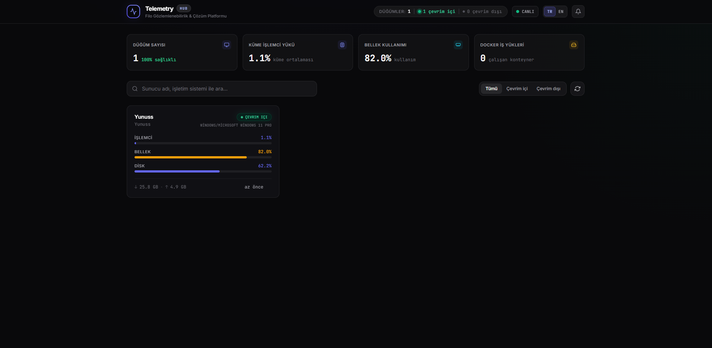
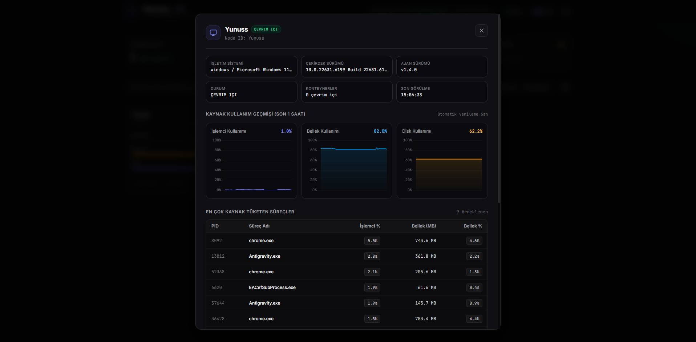
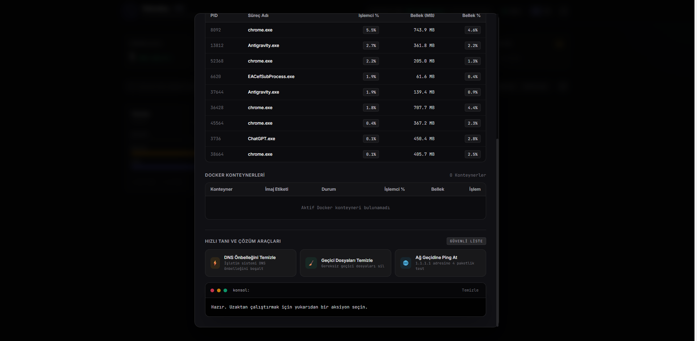

# Telemetry Agent & DevOps Observability Platform

[](https://go.dev)
[](LICENSE)
[](#building-from-source)
[](#footprint)
[](#footprint)

<p align="center">
  
</p>

A **zero-dependency, ultra-lightweight system telemetry agent and central observability control plane** written in pure Go. Inspired by [Beszel](https://github.com/henrygd/beszel) and [node_exporter](https://github.com/prometheus/node_exporter), the platform features multi-subsystem hardware telemetry, top process consumption tables, Docker container observability, threshold-based alerting with Discord/Slack webhooks, and secure, whitelisted remote remediation actions.

Both the **Agent** (`telemetry-agent`) and **Hub** (`telemetry-hub`) compile to statically linked, standalone binaries with zero runtime dependencies.

---

## Features & UI Walkthrough

The Telemetry Hub embeds a responsive, dark-mode web dashboard inspired by modern design systems (TailAdmin & shadcn/ui). It provides full fleet-level awareness, node inspection, and remediation without third-party dependencies or external databases.

### Fleet Overview & Real-Time Telemetry
- **Cluster KPIs:** Live summary of total nodes, online health ratio, cluster-wide aggregate CPU load, memory allocation, and active Docker containers.
- **Dynamic Node Cards:** Visual resource gauges with color-coded warning/critical states, network bandwidth throughput counters, and relative heartbeat timestamps.
- **Instant Search & Filtering:** Filter nodes in real time by hostname, operating system, or connectivity status (All / Online / Offline).
- **Dual-Language i18n:** Built-in Turkish (**TR**, default) and English (**EN**) language switching persisted across sessions.

### Node Inspection & Embedded Action Terminal

<p align="center">
  
  
</p>

- **Deep Hardware & OS Telemetry:** Inspect kernel versions, CPU architecture, host uptime, and 1-hour time-series metric graphs for CPU, RAM, and storage.
- **Top Resource-Consuming Processes:** Real-time visibility into the highest CPU- and memory-consuming processes (`chrome.exe`, background workers, system daemons).
- **Docker Container Observability:** Monitor container status, CPU percent, and memory limits for isolated services.
- **Whitelisted Remote Actions & Web Terminal Console:** Safely trigger DNS flushing, temp directory cleaning, network gateway pings, and container restarts with instant streaming execution output in the interactive console.

---

## Complete Feature Matrix

| Capability | Scope | Details |
|---|---|---|
| **Zero Runtime Dependencies** | Agent & Hub | Statically linked pure-Go binaries (`CGO_ENABLED=0`), no libc or external daemon dependencies. |
| **Minimal Footprint** | Agent | Strict `< 15 MB` RSS memory and `< 0.5%` CPU utilization between telemetry ticks. |
| **Multi-Subsystem Telemetry** | Agent | CPU (aggregate + per-core), RAM (physical + swap), Disk (mount points + I/O), Network (TX/RX bandwidth & drops), and Host metadata. |
| **Top Process Monitoring** | Agent & Hub | Real-time extraction of top resource-consuming processes (PID, Name, CPU %, Memory RSS, Memory %). |
| **Docker Container Monitoring** | Agent & Hub | Auto-discovers containers via Unix socket or Windows named pipe (Status, CPU %, Memory usage / limit). Gracefully skips when Docker is absent. |
| **Embedded Control Plane** | Hub | Built-in SQLite storage (`modernc.org/sqlite`), Server-Sent Events (SSE) live updates, and embedded dark-mode Tailwind CSS dashboard. |
| **Threshold Alerting Engine** | Hub | Evaluates CPU, Memory, Disk thresholds, and offline node transitions (>30s silence) with 10-minute cooldown protection and green recovery notifications. |
| **Universal Webhook Dispatcher** | Hub | Rich Discord embeds (colored status bars) and Slack-compatible attachments with instant delivery testing. |
| **Secure Remote Actions** | Agent & Hub | Whitelisted diagnostic & remediation actions (`flush_dns`, `clean_temp`, `ping_gateway`, `restart_docker_container`) with interactive web terminal console. |

---

## Platform Architecture

```
┌────────────────────────────────────────────────────────┐
│                   Managed Host (Agent)                 │
│                                                        │
│   ┌──────────────┐     ┌────────────────────────────┐  │
│   │ config (ENV) │────▶│       Orchestrator         │  │
│   └──────────────┘     │   (ticker every N seconds) │  │
│                        │                            │  │
│   ┌──────────────┐     │  ┌───────────┐ ┌────────┐  │  │
│   │ Host / CPU   │◀────┤  │ Memory    │ │ Disk   │  │  │
│   └──────────────┘     │  └───────────┘ └────────┘  │  │
│   ┌──────────────┐     │  ┌───────────┐ ┌────────┐  │  │
│   │ Top Processes│◀────┤  │ Network   │ │ Docker │  │  │
│   └──────────────┘     │  └───────────┘ └────────┘  │  │
│                        └─────────────┬──────────────┘  │
│   ┌──────────────┐                   │ Report Payload  │
│   │ Action Worker│◀───┐              ▼                 │
│   │ (DNS/Ping/   │    │      ┌───────────────┐         │
│   │  Temp/Docker)│    │      │  HTTPSender   │         │
│   └──────┬───────┘    │      │ (retry+jitter)│         │
│          │            │      └───────┬───────┘         │
└──────────┼────────────┼──────────────┼─────────────────┘
           │ Result     │ Poll Actions │ POST /api/v1/metrics
           ▼            ▼              ▼
┌────────────────────────────────────────────────────────┐
│                 Central Telemetry Hub                  │
│                                                        │
│   ┌────────────────────┐     ┌───────────────────────┐ │
│   │  REST API & SSE    │────▶│ SQLite DB (modernc)   │ │
│   │  Router (Go 1.22+) │     │ (nodes, history, acts)│ │
│   └──────────┬─────────┘     └──────────┬────────────┘ │
│              │                          │              │
│              ▼                          ▼              │
│   ┌────────────────────┐     ┌───────────────────────┐ │
│   │  Embedded Web UI   │     │ Alerting Engine       │ │
│   │  (Dark Dashboard)  │     │ (Discord / Slack)     │ │
│   └────────────────────┘     └───────────────────────┘ │
└────────────────────────────────────────────────────────┘
```

---

## Quick Start

### 1. Launch the Telemetry Hub
```bash
# Start Hub server with embedded SQLite and dark dashboard
./dist/telemetry-hub --listen=:18080 --db=telemetry.db
```
Open **[http://localhost:18080](http://localhost:18080)** in your browser.

### 2. Launch the Telemetry Agent
In a separate terminal on any monitored server:
```bash
./dist/telemetry-agent --hub-url=http://localhost:18080 --interval=5s
```

---

## Remote Actions & Remediation

Security is paramount: **arbitrary shell execution is strictly disallowed**. The agent only executes whitelisted, parameter-validated actions with a hard 10-second timeout:

| Action | Supported Systems | Description |
|---|---|---|
| `flush_dns` | Windows, Linux, macOS | Flushes local DNS resolver (`ipconfig /flushdns`, `resolvectl flush-caches`, `dscacheutil`). |
| `clean_temp` | All platforms | Safely purges temporary files in the OS temp directory, preserving active/locked files. |
| `ping_gateway` | Windows, Linux, macOS | Executes a 4-packet diagnostic ping to `1.1.1.1` or a sanitized custom target. |
| `restart_docker_container` | Docker hosts | Safely restarts a target Docker container (`params: {"container_id": "name"}`). |

### Triggering Actions via Web UI
Inside the Node Details modal:
1. Click **⚡ Flush DNS Cache**, **🧹 Clean Temp Files**, or **🌐 Ping Diagnostic**.
2. For Docker nodes, click **Restart** on any container row.
3. Observe live execution status, duration ($ms$), and raw output in the embedded terminal console.

---

## Alerting Engine & Webhooks

The Hub includes a background alerting engine that evaluates rules on each metric tick:
- **CPU Threshold Alert:** Breaches when CPU utilization exceeds configurable threshold (default `90%`).
- **Memory Threshold Alert:** Breaches when RAM utilization exceeds threshold (default `90%`).
- **Disk Threshold Alert:** Breaches when Disk usage exceeds threshold (default `90%`).
- **Offline Node Alert:** Fires when an agent has been silent for $> 30\text{s}$.
- **Flapping Protection:** 10-minute cooldown window prevents repeated spam for the same condition.
- **Auto-Resolution:** Emits a green **RESOLVED** notification when conditions clear.

### Supported Webhooks
- **Discord Webhooks:** Rich embeds with colored sidebars (Red `#EF4444` firing, Green `#22C55E` resolved), node metadata, and timestamps.
- **Slack / Generic JSON Webhooks:** Compatible with standard Slack incoming webhook attachments.

Configure webhooks directly in the dashboard via the **Bell Icon** in the top navigation bar.

---

## API Reference

### Telemetry & Ingestion
| Method | Endpoint | Description |
|---|---|---|
| `POST` | `/api/v1/metrics` | Ingests a `TelemetryReport` payload from an agent. |
| `GET` | `/api/v1/nodes` | Lists all active and registered nodes with current health metrics. |
| `GET` | `/api/v1/nodes/{id}` | Fetches full telemetry snapshot for a specific node. |
| `GET` | `/api/v1/nodes/{id}/history?window=1h` | Returns time-series metric points for charting. |
| `GET` | `/api/v1/events` | Server-Sent Events (SSE) stream pushing updates on each node change. |

### Remote Actions Dispatcher
| Method | Endpoint | Description |
|---|---|---|
| `POST` | `/api/v1/nodes/{id}/actions` | Enqueues a whitelisted action request for a node. |
| `GET` | `/api/v1/nodes/{id}/actions/pending` | Agent polls for queued actions. |
| `POST` | `/api/v1/nodes/{id}/actions/{action_id}/result` | Agent reports stdout, stderr, exit code, and duration. |
| `GET` | `/api/v1/nodes/{id}/actions/{action_id}` | Polls action execution status and terminal output. |
| `GET` | `/api/v1/nodes/{id}/actions` | Retrieves recent action history for a node. |

### Alerting & Webhooks
| Method | Endpoint | Description |
|---|---|---|
| `GET` | `/api/v1/alerts/config` | Retrieves current webhook URL and metric thresholds. |
| `POST` | `/api/v1/alerts/config` | Updates alert rules and webhook destination. |
| `POST` | `/api/v1/alerts/test` | Dispatches an immediate test notification to verify delivery. |

---

## Agent Configuration Reference

All settings can be provided as CLI flags or environment variables:

| Flag | Env Var | Default | Description |
|---|---|---|---|
| `--hub-url` | `HUB_URL` | `http://localhost:8080` | Base URL of the telemetry hub |
| `--auth-token` | `AUTH_TOKEN` | _(empty)_ | Bearer token for hub authentication |
| `--node-id` | `NODE_ID` | OS hostname | Stable unique identifier for the host |
| `--interval` | `INTERVAL` | `15s` | Telemetry sampling interval (minimum `1s`) |
| `--log-level` | `LOG_LEVEL` | `info` | Logging verbosity: `debug`, `info`, `warn`, `error` |
| `--request-timeout` | — | `10s` | HTTP request timeout per attempt |
| `--max-retries` | — | `5` | Exponential backoff retry attempts per tick |
| `--retry-base-delay` | — | `500ms` | Initial backoff delay before first retry |
| `--retry-max-delay` | — | `30s` | Maximum retry backoff delay cap |

---

## Building from Source

**Prerequisites:** Go 1.22+, Git

```bash
git clone https://github.com/Terabithia1572/telemetry-agent.git
cd telemetry-agent

# Build both binaries with zero CGO dependencies
make build-all

# Or build individually:
CGO_ENABLED=0 go build -trimpath -ldflags="-s -w" -o dist/telemetry-agent ./cmd/agent
CGO_ENABLED=0 go build -trimpath -ldflags="-s -w" -o dist/telemetry-hub ./cmd/hub
```

### Running Tests
```bash
go test -v ./...
go vet ./...
```

---

## Footprint & Resource Utilization

The agent is engineered to be negligible on production hosts:

| Metric | Target | Actual |
|---|---|---|
| **RSS Memory** | `< 15 MB` | `~8–12 MB` |
| **CPU Usage** | `< 0.5%` idle | `< 0.1%` |
| **Binary Size** | Minimal | Single stripped binary (`~7 MB` Agent, `~11 MB` Hub with embedded UI) |
| **Dependencies** | Zero | `CGO_ENABLED=0` static binary, runs on bare Alpine or `scratch` |

---

## License

MIT License. Designed with high-performance systems engineering principles.
